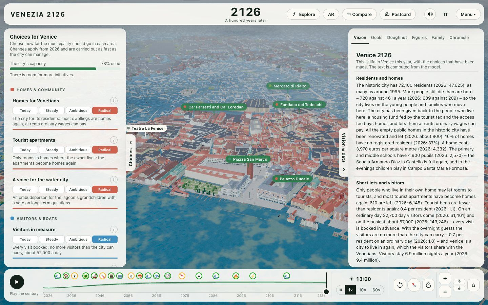
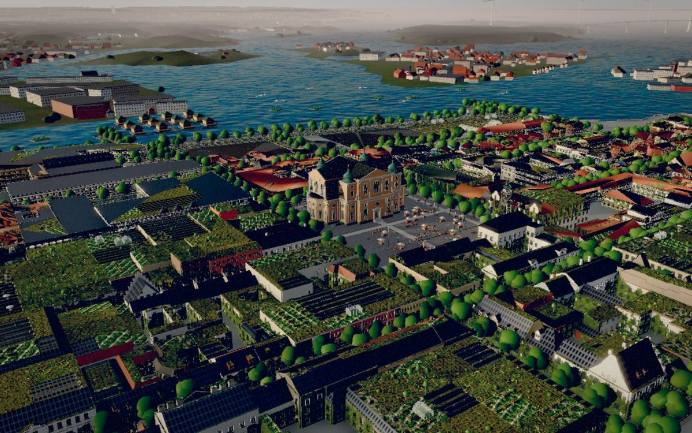
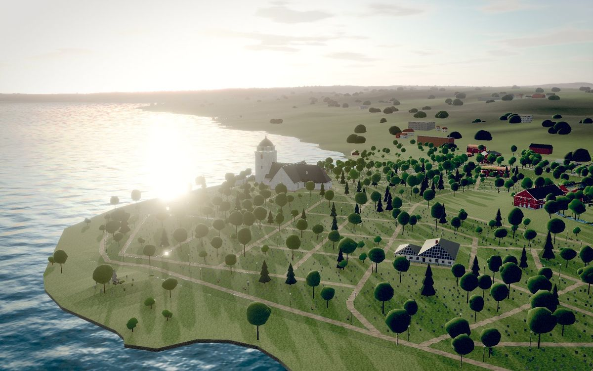
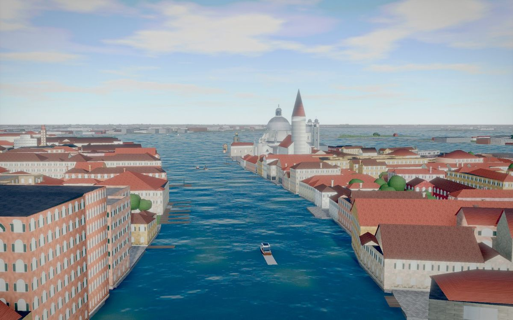
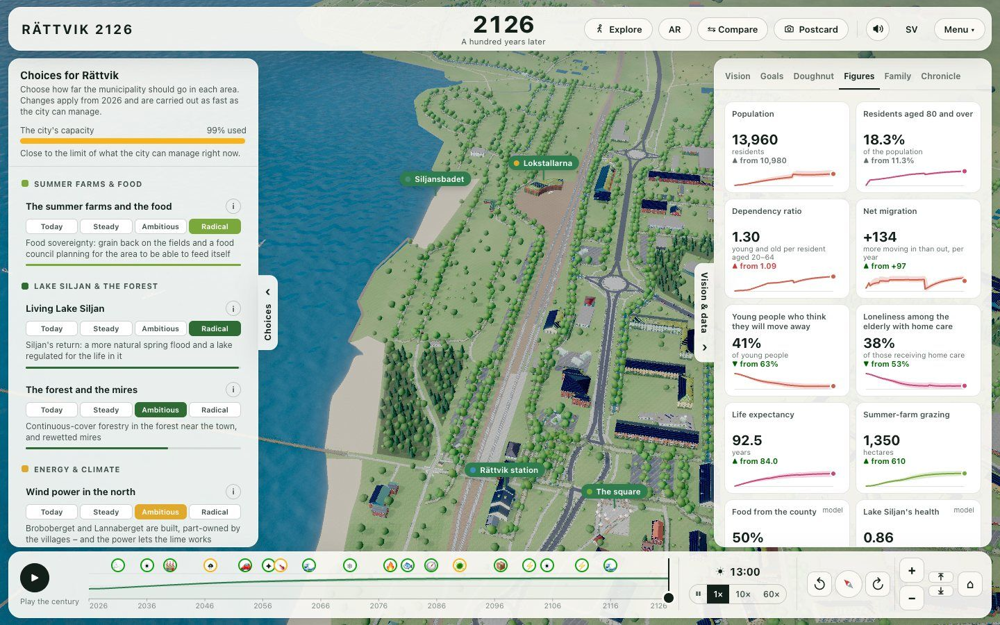
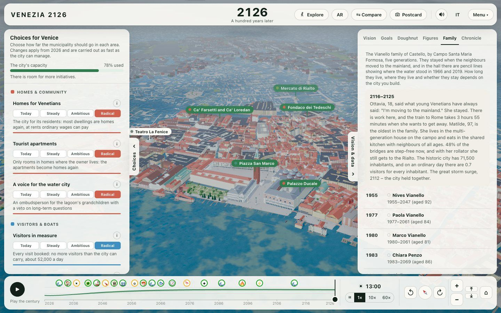
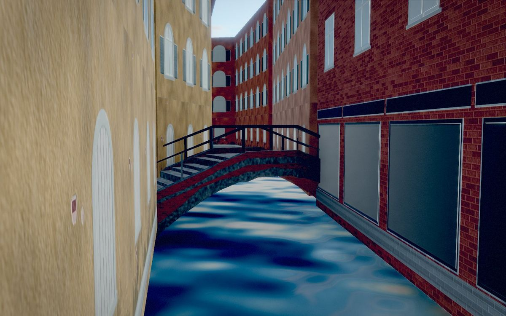
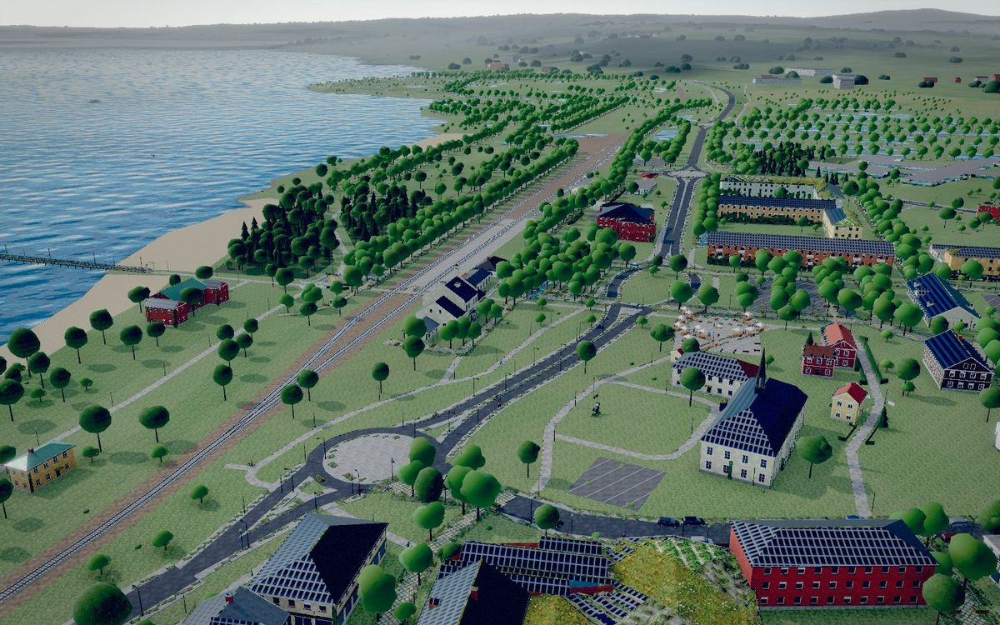

# Sustainable Builder

[](https://www.patreon.com/AndersBjarby)

**A research-based vision of your town, a hundred years ahead.** Name a place – a town, a village, a
district – and an AI coding agent (Claude Code or Codex) builds a site like
[Kalmar 2126](https://bjarby.com/kalmar-2126/): the real streets and houses in 3D, the municipality's own
statistics and deep research with a source for every number, a model of the place that plays the century
2026–2126 year by year under the choices you make, visions to compare, a family that lives through five
generations, a journey decade by decade, crises that test the place – and, if you like, a film with a
narrator and music.

[](https://bjarby.com/venezia-2126/)

Live: **[Kalmar 2126](https://bjarby.com/kalmar-2126/)** (the original the engine comes from) ·
**[Rättvik 2126](https://bjarby.com/rattvik-2126/)** and **[Venezia 2126](https://bjarby.com/venezia-2126/)**
(built with this repository).

| [Kalmar 2126](https://bjarby.com/kalmar-2126/) | [Rättvik 2126](https://bjarby.com/rattvik-2126/) | [Venezia 2126](https://bjarby.com/venezia-2126/) |
| :---: | :---: | :---: |
| [](https://bjarby.com/kalmar-2126/) | [](https://bjarby.com/rattvik-2126/) | [](https://bjarby.com/venezia-2126/) |

## Quick start

You need **Python 3.10+**, **Node.js 20+**, **Blender 4.2+**, **ffmpeg** (for the film) and ~2 GB of disk.

```sh
git clone https://github.com/fltman/sustainable-builder.git
cd sustainable-builder
```

Open the folder in **Claude Code** (`claude`) or **Codex** (`codex`) and say what you want:

> Bygg Ystad 2126. · Make a vision for Visby, with a film. · Gör en hållbar vision för Rättvik.

The agent checks your setup, finds the place, asks a few things once (languages, terrain, film, narrator,
music, how far to refine the houses), builds the city, researches it (Kolada's key figures for Swedish
municipalities, then deep research in parallel: climate and water, energy and travel, society and health,
nature and food, tourism and economy, the municipality's own plans, places and history), writes the
place's model, visions, family, journey and events, and starts the site at **http://localhost:5230**.

Without an agent the tools still run:

```sh
python3 sustainable.py doctor               # installs and checks everything (once)
python3 sustainable.py make "Ystad"         # find → build → Kolada → an empty vision to write on
python3 sustainable.py site ystad           # the site
```

## What gets built

1. **The city** – streets, buildings, parks, water, trees and terrain from OpenStreetMap and
   Lantmäteriet/Copernicus, built in Blender and streamed to the browser in 60 m tiles
   (the pipeline of [wasteland-builder](https://github.com/fltman/wasteland-builder)).
2. **The starting point** – sourced records in `cities/<slug>/vision/research/`: ~70 from Kolada, a few
   dozen for all of Sweden, and 200–300 from the deep research, each with its value, year, source URL and
   confidence, in Swedish and English.
3. **The model** – the place's own. Which levers exist, what they mean there and how far they move things
   come from the place's research, not from another town's model: a new place starts empty
   (`vision <slug> init`), and `research <slug> check` flags anything borrowed from Kalmar. The engine runs
   the century for every place – how fast choices are carried out and what the city can manage, three
   climate worlds, the rising sea or lake, events, uncertainty bands and the 17 goals. Every starting value
   names its record; every effect its evidence.
4. **The site** – choose levers or play a vision through the century; the 3D town changes where and how the
   place's vision allows (no solar panels on Venice's palaces), the numbers and the 17 goals follow, the
   family lives its life, events strike, and you can print your vision, send a postcard or walk the streets.
5. **The film** (optional) – rendered from the site itself, with a narrator (ElevenLabs) and music
   (Suno), in the place's languages.

| The numbers: measured in 2026, computed for 2126 (Rättvik) | A family through five generations (Venice) |
| :---: | :---: |
|  |  |
| **From a gondola: a vaulted footbridge (Venice)** | **Streets that became gardens (Rättvik)** |
|  |  |

## Examples

- **Kalmar** (`examples/kalmar/`) – the original: a coastal city with a rising sea, a bridge to Öland and
  a university. The engine reproduces Kalmar 2126's numbers exactly (a test guards it).
  [bjarby.com/kalmar-2126](https://bjarby.com/kalmar-2126/)
- **Rättvik** (`examples/rattvik/`, built with this repository) – a town of 11 000 by Lake Siljan in
  Dalarna: an old population, summer farms, summer guests, a regulated lake and a lime works.
  [bjarby.com/rattvik-2126](https://bjarby.com/rattvik-2126/)
- **Venezia** (`examples/venezia/`, the first place outside Sweden) – the historic city of Venice, in
  Italian and English: 47 625 residents against 174 808 in 1951, more tourist beds than residents, MOSE
  and the lagoon, and footbridges vaulted so a gondola passes under them.
  [bjarby.com/venezia-2126](https://bjarby.com/venezia-2126/)

Build one yourself with `python3 sustainable.py example rattvik` (or `venezia`).

## Credits and licenses

- The site's engine: **Kalmar 2126**; the city pipeline: **Wasteland Builder** – both by Anders Bjarby.
- Map data © [OpenStreetMap contributors](https://www.openstreetmap.org/copyright), ODbL. Terrain ©
  Lantmäteriet (CC BY 4.0) or Copernicus. Statistics: Kolada (RKA), SCB, SMHI and the sources each
  record names.
- Code: MIT ([LICENSE](LICENSE)). Bundled sounds, music and models: see [THIRD_PARTY.md](THIRD_PARTY.md).
- Built with Blender, three.js, three-mesh-bvh, glTF-Transform, meshoptimizer, Shapely, Vite and Playwright.

## På svenska

Klona repot, öppna mappen i Claude Code eller Codex och skriv till exempel *"Bygg Ystad 2126"*. Agenten
bygger staden i 3D ur OpenStreetMap och Lantmäteriets höjddata och hämtar kommunens nyckeltal ur Kolada.
Den forskar sedan, med en källa för varje siffra, om klimat och vatten, energi och resor, samhälle och
hälsa, natur och mat, turism och ekonomi, kommunens egna planer och ortens historia. Ur det skriver den
ortens egen modell (vilka vägval som finns där och vad de gör, byggt på ortens egen forskning och mätdata,
inte på en annan stads), visionerna, släktkrönikan, Resan och händelserna. Du får en sajt där du väljer
ortens väg de kommande hundra åren och ser den växa fram. Om du vill blir det också en film med
berättarröst och musik.

Exempel: [Kalmar 2126](https://bjarby.com/kalmar-2126/) · [Rättvik 2126](https://bjarby.com/rattvik-2126/) ·
[Venezia 2126](https://bjarby.com/venezia-2126/)
